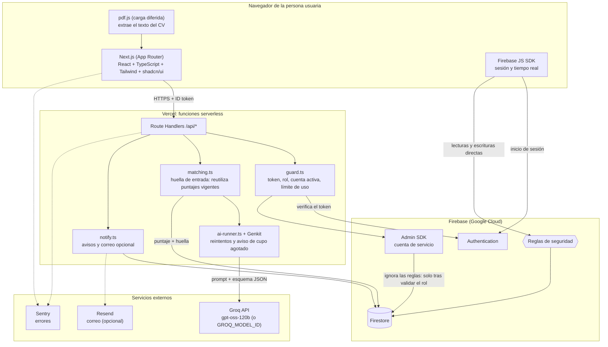
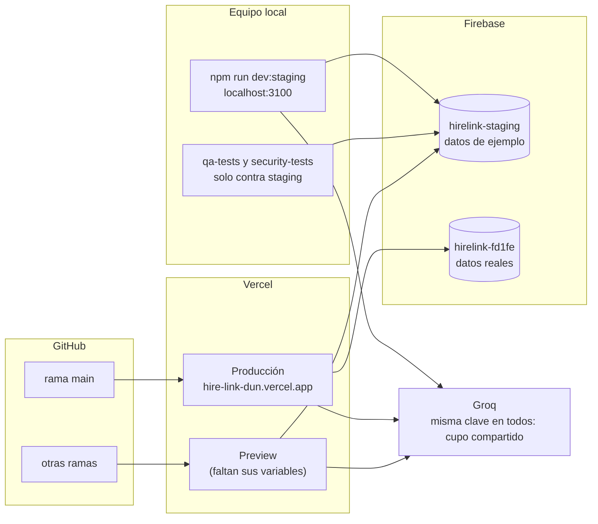
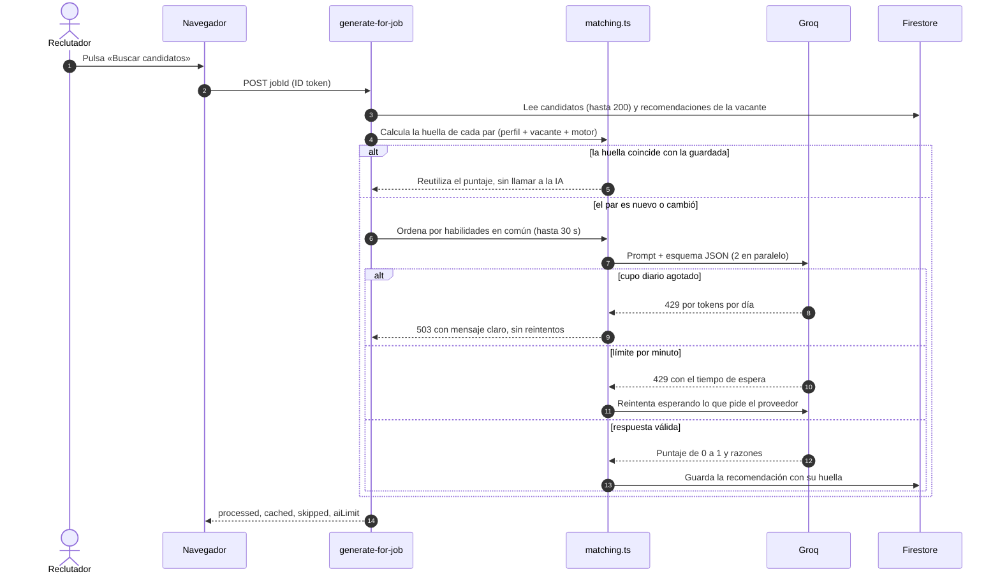

# Arquitectura de HireLink

Vista actualizada del sistema al cierre del proyecto. Los diagramas están en Mermaid (GitHub los dibuja directamente).
Los de la documentación del capítulo 7 siguen en [DIAGRAMAS_MERMAID.md](DIAGRAMAS_MERMAID.md); este documento agrega los
cambios de las Semanas 4 a 6 (staging, reutilización de puntajes de la IA, cupo diario y modelo de respaldo).

## 1. Componentes

**Idea central.** El navegador lee y escribe Firestore directamente, protegido por las **reglas de seguridad**
(`firestore.rules`). Todo lo que necesita privilegios (borrar en cascada, avisar a otra persona, llamar a la IA) vive en
**Route Handlers** autenticados bajo `src/app/api/`, que usan el Admin SDK solo después de comprobar el rol, la empresa y
el límite de uso.

## 2. Entornos y despliegue

| Entorno | Dónde corre | Firebase | Datos |
|---|---|---|---|
| Desarrollo | `npm run dev:staging` | `hirelink-staging` | Ejemplo (`seed`) |
| Staging | Despliegues Preview de Vercel (variables pendientes) | `hirelink-staging` | Ejemplo (`seed`) |
| Producción | Vercel, rama `main` | `hirelink-fd1fe` | Reales |

La clave de Groq es la misma en los tres, así que **comparten el cupo diario de la IA** (200 000 tokens para el modelo
principal). Detalles y plan B en [ENTORNOS.md](ENTORNOS.md).

## 3. Cómo se calculan las recomendaciones

Reglas que conviene recordar:

- Cada recomendación guarda un `inputHash` de lo que vio el modelo (perfil, CV, vacante y versión del motor). Si no
  cambió, el puntaje se reutiliza: guardar el perfil dos veces sin cambios no gasta tokens.
- Se evalúa primero lo que no tiene puntaje y, dentro de eso, lo que más habilidades de la vacante tiene en común con el
  perfil (`overlapScore`).
- El presupuesto de una llamada es de 30 s para iniciar evaluaciones y 52 s como límite duro (Vercel corta a los 60 s).
- Si la vacante se elimina mientras la IA trabaja, no se guarda la recomendación.

## 4. Decisiones de diseño que explican el sistema

| Decisión | Motivo |
|---|---|
| El cliente accede a Firestore bajo reglas, no por una API para todo | Menos código, tiempo real gratis y la seguridad vive en un solo archivo versionado |
| La IA solo se llama desde el servidor | La clave nunca llega al navegador y se puede limitar el uso por persona |
| El PDF del CV no se sube | Evita Storage (requiere plan de pago) y guardar documentos con datos personales |
| Identificadores deterministas (`{uid}_{jobId}`, postulación con el uid) | Evita duplicados sin transacciones |
| Borrados en cascada en el servidor | Firestore no borra subcolecciones al eliminar un documento |
| Reutilización de puntajes por huella | El plan gratuito de la IA es limitado; repetir una acción sin cambios no debe costar |
| Búsqueda en el cliente | Volumen de piloto y costo cero ([DECISION_SEARCH.md](DECISION_SEARCH.md)) |

## 5. Seguridad en capas

1. **Reglas de Firestore:** rol, propiedad, aislamiento entre empresas, cuentas suspendidas y tamaños máximos.
2. **Route Handlers:** `requireUser` (token, cuenta existente y activa, rol) y `enforceRateLimit` en cada endpoint.
3. **Cabeceras HTTP** (`next.config.mjs`): política de contenido (`Content-Security-Policy`), HSTS, `X-Frame-Options`,
   `nosniff`, política de referencia, de permisos y de apertura entre orígenes.
4. **Datos de entrada:** esquemas de `zod` en formularios, topes de tamaño y normalización de lo que devuelve la IA.
5. **Pruebas:** `security-tests/` (reglas, API y carga) y `qa-tests/` (unitarias, regresión con navegador y sondas).
